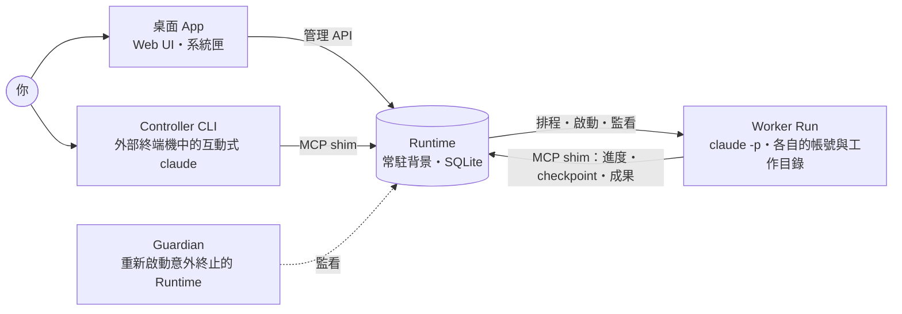

# Baton

Baton 是 Windows 桌面應用程式，讓多個 Claude Code 帳號在同一個平台上分工完成長時間的工作。你在終端機裡和 **Controller** 討論目標，它把目標拆成 Task，派給以其他帳號在背景執行的 **Worker**。常駐的 **Runtime** 負責排程、額度、交接、驗證、持久化與恢復；需要你決定的事集中在桌面 App 的「裁定」頁。

> Baton 是暫定的產品名稱，repo 名稱也尚未更改。

## 目前狀態

- 平台功能已實作，並以 Runtime harness、前端測試與 UI E2E 自動化測試涵蓋。
- 需要真實 Windows 與真實 Claude Code 的[手動驗收](docs/windows-acceptance.md)尚未執行。Windows 11 25H2／26H2 × Home／Pro 四種組合驗收完成前，不宣稱正式支援。
- 還沒有發行版，需要[從原始碼建置](#從原始碼建置與安裝)。
- 只有建置時設定了更新來源的版本才會檢查更新；更新清單的託管位置尚未決定。

## 它能做什麼

- **原生的 Controller**：從 App 開啟一個互動式 Claude Code（Controller CLI）。它的工作目錄就是 Workspace，已接好平台工具並載入內建的 Controller 操作手冊。你看得到它的每個工具呼叫，也能照常使用 Claude Code 的指令、skills 與快捷鍵。
- **多帳號並行**：最多 8 個 Claude Code 帳號（Account Profile），各自獨立登入。Runtime 依相依、優先序、授權、額度與並行上限決定由哪個帳號執行。
- **額度不打斷工作**：帳號接近上限時不再接新工作，進行中的 Run 在安全邊界保存 checkpoint 後交接給其他帳號。所有帳號都受限時，Task 保存進度等額度恢復，不消耗修正次數。
- **完成要有證據**：Worker 宣稱完成或程序結束都不算完成。Task 必須通過契約宣告的確定性檢查（命令結束碼、檔案與成果雜湊），或由你手動接受。
- **隔離的工作目錄**：每個開發 Task 有自己的 Git worktree 與平台分支，通過驗證後經單一整合佇列合併、再跑一次整合驗證，才前移目標分支。研究與文件 Task 使用獨立的輸出目錄，Workspace 不必是 Git repo。
- **授權與裁定**：Workspace 授權以「能力＋目標資源＋限制」表達。範圍內的操作自動允許；範圍外的操作與需要你決定的事都成為裁定請求，只阻擋受影響的 Task。
- **累積知識**：教訓（Lesson）經你確認後才生效，可轉成在派工前攔截的 Guard。每個 Run 啟動時都記錄它載入了哪些決策與教訓。
- **可恢復**：關閉視窗後工作繼續。Runtime 意外終止時由監護程序有限次重新啟動並核對狀態。控制資料庫每日備份，每週自動還原演練一次。

## 運作方式



- **Runtime** 是唯一的控制平面，也是控制資料唯一的寫入者。不需要呼叫模型的規則（准入、排程、交接、驗證、恢復）都由它執行。
- **桌面 App** 是唯一的人工操作入口。只有經 App 提交的裁定才算正式裁定。關閉視窗不會停止 Runtime。
- **Controller CLI** 透過 MCP shim 呼叫 Controller 工具：建立與修改 Task、加相依、派工、取消、提出裁定、接受成果、收發訊息、查詢知識。這些動作都經 Runtime 驗證，它不能繞過 Runtime 寫入控制資料或自己啟動 Worker。Claude Code 本身的檔案與指令操作仍照預設權限模式先詢問你。
- **Worker** 以非互動的 `claude -p` 執行一個 Task，透過 MCP shim 讀取任務契約、回報進度、保存 checkpoint、登記成果或回報受阻。
- **Guardian** 只在 Runtime 確認意外終止時重新啟動它，不派工也不寫控制資料。

詞彙的完整定義見 [GLOSSARY.md](GLOSSARY.md)；主要的幾個：

| 詞彙 | 意思 |
| --- | --- |
| Workspace | 一個工作環境，對應你指定的一個目錄，擁有自己的授權、Goal 與 Task |
| Goal／Task | 要達成的目標，以及拆出來、可以獨立派工與驗收的工作單位 |
| Run | 一次 Agent 執行，綁定一個帳號；交接、重試與恢復會讓同一個 Task 有多個 Run |
| Account Profile | 一個 Claude Code 帳號，有自己獨立的登入與 Session 狀態 |
| 裁定請求 | 需要你決定的事，附選項、取捨、建議與證據 |
| 成果（Artifact） | Task 產生的檔案，有版本與雜湊；通過驗證才算被接受 |

## 系統需求

執行：

- Windows 11 x64（Home／Pro）。Windows 10、ARM64 與 Server 顯示為非正式支援，但不阻擋使用。
- Claude Code 2.1.307 以上，在 Windows 原生執行（不支援 WSL），以及至少一個 Claude 帳號。
- Git for Windows：開發 Task 的 worktree 需要它。
- WebView2 Runtime（Windows 11 內建）。

從原始碼建置另外需要：

- Rust stable（`rustup`），以及含「使用 C++ 的桌面開發」工作負載的 Visual Studio 或 Build Tools。
- Node.js 22 以上、pnpm 9。

## 從原始碼建置與安裝

```powershell
pnpm install
pnpm build --bundle
```

輸出是 `target/release/bundle/nsis/*-setup.exe`（第一次建置會下載 NSIS）。這是單使用者安裝程式，不需要系統管理員權限，預設安裝到 `%LOCALAPPDATA%\Baton`。

不需要安裝程式時，只執行 `pnpm build`，然後直接執行 `target/release/baton-desktop.exe`。它和同一個資料夾裡的 `baton-runtime.exe`、`baton-guardian.exe`、`baton-mcp-shim.exe` 必須放在一起。

## 第一次使用

1. **開啟 Baton**：首次設定精靈會檢查 Claude Code 與 Git，並說明 Baton 會在背景執行。缺少工具時精靈只顯示官方安裝指令，不會替你下載或安裝。
2. **新增帳號**（`帳號` 頁簽）：新增 Account Profile，按「在終端機登入」完成 Claude Code 原生登入，再按「重新核對」。已有登入好的設定目錄（例如 `~\.claude-Work-1`）時，可以用「以既有目錄建立 Profile」直接登記，不必重新登入；Baton 不會修改或刪除這個目錄。
3. **匯入共同設定**（`帳號` 頁簽）：Baton 讀取你平常的 Claude Code 設定（`~\.claude\settings.json`、`~\.claude\CLAUDE.md` 與 `~\.claude.json` 的 `mcpServers`）產生預覽。你看過來源、差異與排除項目後再採用，所有帳號的 Agent 都會使用這份設定。登入資料不會被匯入，看起來像秘密的值也會被排除（以啟發式規則判斷）；原始檔案只讀不寫。
4. **建立 Workspace**：在 `Workspace` 頁簽左側按「建立 Workspace」，選一個目錄（不一定要是 Git repo）。
5. **確認授權**（`更多` → `授權`）：從「研究／文件」或「可信專案開發」範本開始編輯，檢視確認摘要後按「確認並保存授權」。選取目錄不等於授權，確認之前，需要任何能力的工作都不會被派出。部署、遠端寫入、對外發訊、付費、正式資料操作與系統管理員安裝不在任何範本內，只能由你明確加入。
6. **開啟 Controller**（`主控台`）：選一個帳號當 Controller 帳號，按「開啟」。Baton 會在 Windows Terminal（沒有時用系統主控台）開一個標題含「Baton Controller」的視窗。
7. **在終端機描述目標**：Controller 會拆 Task、補齊契約並派工，派工後在背景等待事件。Worker 結束、Task 受阻、裁定被回答或收到訊息時，Claude Code 會原生通知它。

之後主要在 App 的這幾個頁簽追蹤進度：

| 頁簽 | 用途 |
| --- | --- |
| 主控台 | Controller CLI 的狀態、帳號與額度；結束、換帳號重開 |
| 工作 | 依狀態分欄的 Task 看板，以及契約、相依、派工、取消與手動接受成果 |
| 裁定 | 需要你決定的事與超出授權的權限提示，可以批次處理 |
| 成果與品質 | 成果瀏覽、審查、驗證、探索測試 |
| 更多 | 知識與專案理解、流程、時間線、授權與模型覆寫 |

`帳號` 頁簽另有排程（並行容量）設定；`設定` 頁簽有登入時自動啟動、更新、備份、恢復與平台狀態。Controller 與 Worker 自行做的決定記在 Workspace 的 `.baton\ai-decisions.md`，供你事後審閱。

## 使用須知

### Task 什麼時候算完成

每個 Task 都有六項最小契約：目標、輸入與依據、範圍與限制、預期成果、完成與驗證條件、阻礙處理；契約不完整就不能派工。Run 成功結束後，Task 進入驗證：契約宣告了確定性檢查時由 Runtime 執行，全部通過才完成；沒有宣告時，由你在「工作」頁的 Task 卡片上手動接受。

開發 Task 在 `<Workspace>\.baton\worktrees\<Task>` 中工作，簽出平台分支 `baton/<Task>`。驗證通過後排入整合佇列，在 `<Workspace>\.baton\integration` 合併並重跑檢查，成功才前移目標分支，之後 worktree 自動清理（分支與歷史保留）。合併衝突或檢查失敗時，Task 回到可派工，目標分支不受影響。研究與文件 Task 的輸出在 `<Workspace>\.baton\outputs\<Task>`。

### Controller 與帳號

- Controller CLI 開著時，它的帳號不會被派去執行 Worker；關閉後恢復。
- 同一個 Workspace 同時只能開一個 Controller CLI；同一個帳號可以同時當多個 Workspace 的 Controller 帳號。
- 用同一個帳號重新開啟會接續原生 Session。額度快用完時按「換帳號重開」，新的 Session 從平台上的 Task、裁定、成果與 AI 決策紀錄接續。
- Controller CLI 沒開著時，事件只會累積、沒有人處理；Baton 不會自動喚醒 Controller。

### 關閉視窗與完全退出

- 關閉視窗只會隱藏到系統匣，背景工作繼續。
- 系統匣的「完全退出」會限時（最多 40 秒）停止所有平台管理的程序，無法確認停止的程序會列出來。未完成的 Task、成果與裁定都會保留，不會被取消。
- 完全退出後再次開啟時，Workspace 預設暫停，按左側的「繼續工作」才續跑；也可以為個別 Workspace 開啟「完全退出後自動續跑」。
- `設定` 的「登入時自動啟動」與各 Workspace 的「跨登入自動續跑」預設都關閉。
- Runtime 意外終止時，監護程序會重新啟動它（每次恢復最多三次）。重新啟動後 Runtime 先核對程序與資料，不會重複啟動 Worker。

## 資料與安全

- 資料目錄預設是 `%LOCALAPPDATA%\Baton`，包含控制資料庫 `control.sqlite`、成果、備份、日誌，以及由 Baton 建立的 Profile 設定目錄（以既有目錄登記的 Profile 留在原位置）。資料目錄不能放在網路共享或雲端同步資料夾（OneDrive、Dropbox 等）。
- 每個 Profile 的登入資料只存在它自己的設定目錄，由 Claude Code 保管，不會進入控制資料庫、日誌、API 回應或備份。
- Runtime 只監聽 loopback（預設 `127.0.0.1:47821`），管理 API 需要以 DPAPI 保護的桌面憑證。每個 Worker 與 Controller 只拿到綁定自己 Run 的 Agent 憑證。
- Worker 以目前 Windows 使用者的身分執行程式。Workspace 授權限制的是 Agent 被允許做的事，worktree 與授權都不是安全沙箱。
- 每日、套用資料庫 migration 前與正式裁定後（同一小時內合併成一次）會自動備份到 `<資料目錄>\backups\`，保留最近 7 天與 4 週各一份，每週自動還原演練一次，結果顯示在 `設定`。需要還原時執行 `baton-runtime restore <備份目錄> <目標資料目錄>`，目標必須是空目錄。

## 更新與解除安裝

- 更新只會通知。你按「更新並重新開啟」之後，Baton 才下載安裝程式並驗證簽章，接著停止工作、備份、執行安裝程式並重新開啟。下載或簽章驗證失敗時不會停止任何工作。
- 只有建置時設定了 `BATON_UPDATE_ENDPOINT` 與 `BATON_UPDATE_PUBKEY` 的版本會檢查更新，其他版本在設定頁顯示「未設定」。
- 解除安裝會先停止 Runtime 與監護程序並移除登入啟動登記，但保留資料目錄；重新安裝後資料仍在。

## 文件

| 文件 | 內容 |
| --- | --- |
| [開發者指南](docs/development.md) | 目錄結構、建置、測試、各模組的規則與 API |
| [GLOSSARY.md](GLOSSARY.md) | 領域詞彙 |
| [docs/adr/](docs/adr/) | 架構決策紀錄 |
| [Windows 手動驗收清單](docs/windows-acceptance.md) | 需要真實環境的驗收步驟與執行紀錄 |
| [Adapter 契約測試](docs/adapter-contract.md) | 確認測試用的 fake 與真實 Claude Code 行為一致 |

## 授權

以 [MIT](LICENSE) 授權。
